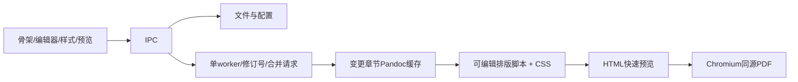
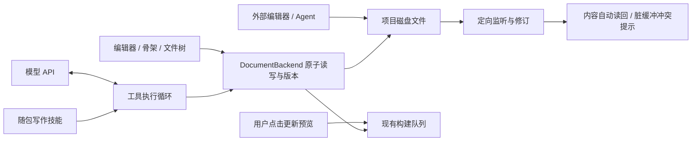

# DOConstruct：独立文档构建工作台

## 目标与边界

独立的本机文档编辑工具，论文/专利只是输入。打开文件夹，以有序章节文件构成骨架，编辑正文、排版Python/JS/PowerShell脚本和CSS；调整字体/页幅/页边距；后台增量构建，快速HTML预览与实际PDF输出并存。与CAMX源码/库/运行时无依赖。

## ADR-001：本机服务 + 成熟编辑器 + 现成排版引擎

Electron正式独立桌面程序，隔离renderer/preload/main与Node后端，排版子进程离开UI；编辑器使用本地打包CodeMirror6（无需CDN）提供Markdown/脚本/CSS/JSON高亮、行号、搜索/替换/撤销/快捷键。Pandoc生成HTML5/MathML；随Electron携带的Chromium打印同一HTML/CSS到PDF。Word正式出版脚本是可配置外部适配器，不作为实时预览引擎。

Electron/Chromium与编辑器随安装包，Pandoc和Python嵌入发行版放resources/vendor；启动统一发现配置或随包资源，不依赖开发机。额外Python模块在依赖面板检查，不默默调用别台机器不存在的路径。

不自行实现Markdown解析器或PDF排版内核，不把DOM快速预览声称为已完成PDF。全局分页仍须重新计算，增量指只重转变动章节、复用未改资源/中间结果，样式修改不重新解析正文。失败保留最后成功预览并显示具体阶段/日志；过期结果不覆盖当前编辑修订。

## 项目与生命周期

每个项目独立doconstruct.json（标题、有序sections、style、layout_script）；可导入既有sections.json/assets目录布局或单个md。正文源为真实文件；手动保存与“更新预览”分离：输入/保存/切文件不跑脚本，只有用户明确点击更新才构建；PDF优先复用有效预览。未保存有明确标记与丢弃提示。无全盘扫描，文件树排除生成/缓存/版本管理目录。原稿演示一律副本。

默认可编辑layout.py和layout.css，layout.py接受JSON上下文（标题/style/各章节已转HTML）从stdin，stdout返回完整HTML。脚本从子进程调用，不在界面线程执行。原有其他排版脚本可作为argv命令运行，显示日志与产物，避免另造旧管线逻辑。

缓存键覆盖输入正文、资源身份/mtime、Pandoc选项/版本；样式或布局脚本只失效合成/PDF。骨架重排复用章节HTML，缺文件明确报错。只构建当前修订快照，单worker串行，自动请求合并为最新，后台任务可取消。

IPC只暴露白名单操作并校验发送窗口；renderer隔离、nodeIntegration关闭，文件工具路径限制在用户打开项目内，原子保存并检查打开时版本防止覆盖外部修改。预览iframe隔离脚本。命令通过原生进程参数调用；PowerShell工具显式启动PowerShell解释脚本。AI命令需用户事先启用权限，执行具有当前用户权限，不把工作目录当作沙箱。PDF使用独立浏览器profile，不影响用户现浏览器。

## 接口契约

前后端Agent先在API.md固定精确JSON，统一成功/错误/任务状态；不得各自发明。至少覆盖open项目、读取/保存文件、保存骨架/样式/脚本设置、start build、inspect/cancel job、预览HTML、导出/下载PDF。编辑器语法种类按后缀自动选择。UI展示已用缓存数/实际重转章节数及阶段耗时，不用假百分比。

## ADR-002：文件、骨架和 AI 共用读写，文件刷新与排版分离

0.2 保留现有 DocumentBackend。骨架是有序的正文引用，可在没有正文时创建空骨架，再逐章添加；文件树是整个项目的资源视图，按用户展开的目录读取，不把图片目录递归扫描进正文清单。删除章节引用不删除文件，文件管理删除移入项目内部回收目录。

后端只监听已知输入和展开目录。磁盘变化使输入修订失效，并通知界面读取变化文件/骨架；干净编辑器自动读回，未保存缓冲保持原状并显示冲突。文件事件不调用排版。预览缓存可以显示旧成品但标记过期；用户明确更新时才构建。

AI 不是第二套文件系统或排版引擎。主进程中的 AiService 用可配置 Chat Completions 或 Responses 接口执行“模型决定工具 → 本机工具执行 → 返回实际结果 → 继续”的循环。读写、骨架配置及校验复用后端；命令权限启用后可传入argv或PowerShell，不要求每条命令先写入项目配置。两种命令共用DocumentBackend工作队列及取消机制，回传实际输出和退出结果；普通文件更新不会中断命令，切换项目和停止任务则取消命令及子进程。AI命令不发布新排版预览，更新预览仍由用户发起。文件工具写入前比较读取版本，撤销同样核对版本；任意命令写入不保证具备文件工具的快照撤回。API Key 通过 Electron safeStorage 加密后存于用户设置目录，不写文档、不返回界面或模型上下文。技能随安装包携带，与 Codex 是否安装无关。

选择该结构而非额外本地HTTP服务/新的Agent框架，是为了保留当前缓存与冲突处理、减少依赖，并让人工编辑、外部Agent和内置AI的结果遵循同一文件语义。真实模型服务的网络延迟与计费由用户选择的端点决定；测试用本地HTTP模型协议端验证真实工具执行，不将模拟模型回应冒充在线服务实测。

每个工作区具有会话索引和独立聊天文件，索引队列串行化新建/选择/权限及任务接收，任务准备时核对epoch、会话与权限。文件工具由统一权限模块限制，命令权限明确属于当前OS用户权限。运行中追加指令留在同一个job，在模型/工具边界跳过旧的未执行调用并按新指令继续，不撤销已执行操作。新任务默认100轮，重复相同失败另作停滞检测。

长对话存储、模型上下文和显示窗口分开：完整记录持久化，新任务模型取最近80条，UI与事件默认100条。上翻历史时冻结显示更新并保住滚动位置，回到最新再同步；不因工具状态更新重画全部历史。消息与代码复制、编辑回输入框和重新尝试复用现有发送路径。

## 验收

新建示例和现论文/专利副本均可打开。改一章仅该章重转；仅改字体/重排不重转正文；脚本着色、脚本改动影响合成；保存重开保留配置；实际PDF可读且字体/边距修改可见。脚本失败/正文错误不吞日志，不把旧预览冒充新结果。
